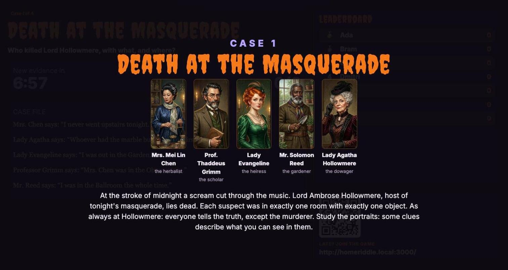
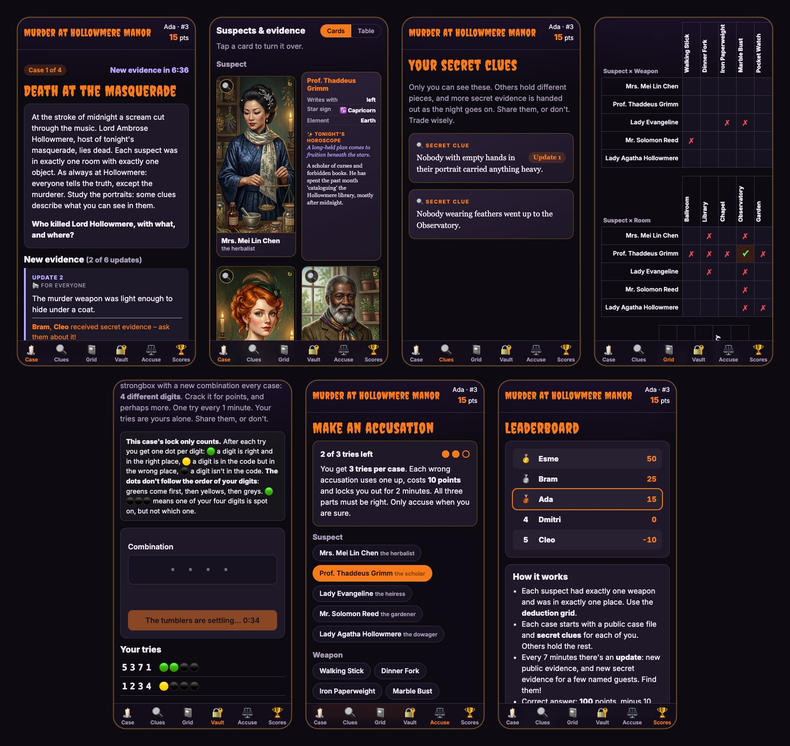

# Homeriddle: a house-party murder mystery

A clue-based game that runs all night on your laptop. Guests join from their phones, each one gets **secret clue cards**, a **hint drops every few minutes** until someone solves the case, and a **live leaderboard** runs on the TV.





## Run it

```bash
node server.js          # needs Node 18+; there's nothing to npm install
```

The terminal prints three links:

| Link | Who | What |
|---|---|---|
| `http://<your-ip>:3000/` | Guests | Join, see secret clues, notebook, accuse, leaderboard |
| `http://<your-ip>:3000/board` | TV / beamer | Big countdown, hints, leaderboard, join QR code |
| `http://<your-ip>:3000/host?key=…` | You | Start cases, pause, force hints, reveal, award points |

If set up only locally, guests must be on the **same Wi‑Fi**.

Options: `PORT=8080 node server.js`, `HOST_KEY=pumpkin node server.js` (fixed host key), `MYSTERY=other.json node server.js` (different story).

## Deploying to a home server

You can also run the game on an always-on machine on your network and deploy with `git push`. Put a bare repository on that machine and give it a `post-receive` hook that checks out `main` into a folder (say `~/homeriddle`) and runs `deploy/restart.sh` there, for example `PORT=3100 ./deploy/restart.sh`. That script:

1. runs `node verify.js`, so a broken case **fails the push and leaves the running game alone**;
2. stops the old server and starts the new one (detached, survives logout) under `deploy/supervise.sh`, which restarts it within seconds if it ever crashes;
3. checks that it answers, and prints the join, TV and host links.


## How a night plays out

1. Guests arrive and scan the QR code on the TV. They enter their name.
2. You hit **Start case 1** on the host page. The TV and phones show the **case file** (public testimonies) and a **dossier** of suspects, weapons and rooms with their traits (hat, height, handedness, heavy/light, upstairs/outside…). Every guest is dealt at least one **secret clue**.
3. It's Murdle logic: each suspect had exactly one weapon and was in exactly one room. Phones have a tap-to-mark **deduction grid**.
4. Every *N* minutes (default 7) an **update** drops: new public evidence, and new secret evidence handed to a few guests, **named on the TV**. Everyone will want to talk to them.
5. The first correct accusation wins big. Updates then stop and everyone else gets a 5‑minute **last call** for half points, after which the truth is revealed on the TV.
6. You start the next case (the story has 4). The host page's **Cases** list can also start, skip to or replay any case.
7. Use **+25 / ±…** on the host page for a costume contest or side challenges. If a guest wasted their 3 tries on a case, **Reset tries** gives them back (the points those guesses cost stay; refund them with ±… if you like).

One phone, one detective: while a case is on, a phone that already has a player can't join again (extra accounts would get extra clues and accusations). A guest who lost their login uses **Copy rejoin link** on the host page. Players who joined from the same phone outside a case are flagged on the host page. Only the machine running the server (`localhost`) is exempt, so to test with several players mid-case, run the game locally; on the home server your laptop counts as one phone.

**The vault** is a side puzzle in every case (🔐 tab on the phones). Its code is 4 different digits, new each case. Every try gets private feedback (🟢 right digit, right place; 🟡 right digit, wrong place; ⚫ not in the code), and each guest can try once a minute. The style alternates: cases 1 and 3 use **Mastermind** (sorted counts, so you don't learn which digit was right), cases 2 and 4 **Wordle** (a colour under every digit, easier). A case can set `"vaultStyle": "mastermind"` or `"wordle"`. Everyone who opens it gets +40 points, and the first also finds the case's **golden clue**. Since the points are the same, later openers can't tell the vault was already emptied. Vault points stay off the leaderboard until the case is revealed (only the opener's phone and the host page show them), so a jumping score doesn't give an opener away. The TV only announces that *someone* is trying. The host page shows the code, the openers and an on/off switch. Points and the cooldown are in `settings.vault`; a golden clue is a clue with `"vault": true`, and `verify.js` checks it and shows how much it narrows the case.

The host page also shows a **difficulty curve** for the current case: how many answers are still possible at each update if guests pooled everything, or only public clues. That tells you whether to speed up updates, or wait because a group is close.

**Scoring** (editable in `mystery.json` → `settings`): correct = 100 − 10 per update so far (min 30), +50 for the first solver, half points during last call; a wrong accusation costs 10 points plus a 2‑minute cooldown, max 3 wrong per case.

## Writing your own mystery

Everything lives in `mystery.json`. A case has three `categories` (suspects first) with the same number of options, each option with `traits`; a `solution`; and `clues`. Each clue has:

- `text`: what players read
- `public`: `true` shows it to everyone; otherwise it's a secret card
- `release`: `0` = at the start, `1` = with the first update, and so on
- `rule`: the clue in machine-readable form, so it can be checked

Each option can also have:

- `icon`: an emoji shown on its character card (e.g. `"🔮"`)
- `horoscope`: "tonight's horoscope", shown on the back of the card. Every suspect also has a `sign` and `element` trait (Fire, Earth, Air, Water); cases 1 and 4 use the elements in clues, e.g. `{"with": ["murderer", {"who": {"element": "Earth"}}]}`.
- `bio`: a short backstory on the back of the card. Keep traits like hats or height out of it, since those can differ between cases.
- `image`: a picture instead of the generated portrait. Put the file in `public/img/` and use `"image": "/img/governess.jpg"`. Tall portraits work best; the card shows the top part and players can tap 🔍 to see the whole picture.

Add `"focus": "50% 45%"` to choose which part of a tall picture shows on the card (horizontal and vertical position). Weapons and objects default to the lower middle, portraits to the top.

A trait marked `"visual": true` (in the category's `traits` list) is used by the checker but **not printed** on cards or in the table, so players must spot it in the portraits. Only write picture clues that nobody could misread from the image.

Each case has its own five suspects, with portraits in `public/img/`.

Before the first case, the TV shows the lineup in `lobbyCast`: suspects picked from any case, e.g. `{ "case": 2, "id": "housekeeper" }`. Without it, the TV shows the first case's suspects.

**Prefer traits that split the suspects into groups** (2 vs 3: lady/gentleman, feathers, beard, holding a book…). A trait only one suspect has (the mask, the cross, pearls) just names that person, so a clue built on it is really "X was in Y" in disguise. Save unique traits for the final update, which is meant to settle the case.

Rule building blocks (see the top of `logic.js`):

| Clue | Rule |
|---|---|
| "Everyone wearing a hat carried something light." | `{"with": [{"who": {"hat": true}}, {"what": {"weight": "light"}}]}` |
| "The candlestick never went upstairs." | `{"apart": ["what:candlestick", {"where": {"floor": "upstairs"}}]}` |
| "The murderer was upstairs." | `{"with": ["murderer", {"where": {"floor": "upstairs"}}]}` |
| Testimony (only the murderer lies) | `{"says": "who:crane", "that": <rule>}` |
| Two truths and a lie | `{"exactly": 2, "of": [<rule>, <rule>, <rule>]}` |
| Combinations | `{"not": …}`, `{"and": [...]}`, `{"or": [...]}`, `{"if": …, "then": …}` |

Then run:

```bash
node verify.js --verbose
```

It tries every possible arrangement and prints, per update, how many answers remain and which ones. The server refuses to start if a case has no solution or contradicts your stated `solution`, and warns if it has more than one.

To check that the whole game still works after a change, run:

```bash
npm test
```

It runs `verify.js`, then plays every case through as five guests and a host (joining, dealing, updates, the vault, accusations, last call, a restart mid-case, replay and reset) on a copy of the game in a temporary folder, with timers shortened to seconds. It takes about a minute and never touches your real game state. A deploy only runs `verify.js`.

Game state is saved to `data/state.json`, so a crash or restart resumes where you left off. Use **Wipe everything** on the host page (or delete `data/`) before the real party.

## License

The code is released under the [MIT License](LICENSE).

The pictures in `public/img/` were generated with Google Gemini. They are not covered by the MIT License and are provided as is. AI-generated images may not be protected by copyright, so no rights in them are granted or claimed.

`public/vendor/qrcode.min.js` is [qrcodejs](https://github.com/davidshimjs/qrcodejs) by davidshimjs, under the MIT License ([`public/vendor/qrcode.LICENSE`](public/vendor/qrcode.LICENSE)).
